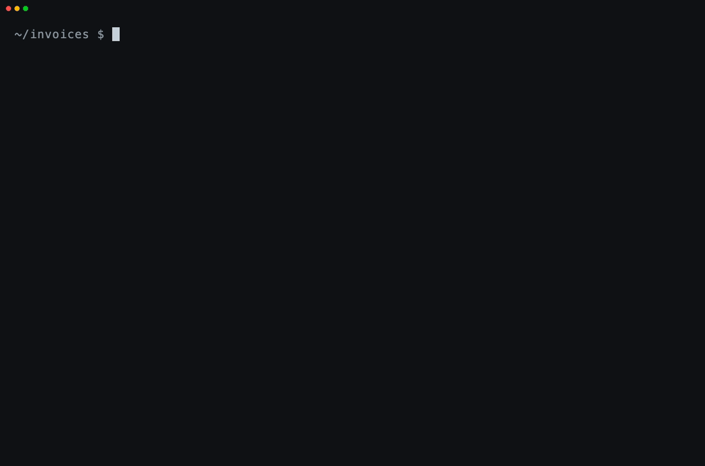
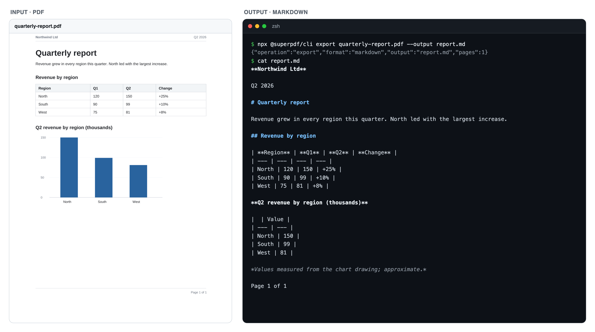

<div align="center">

<h1>
  <picture>
    <source media="(prefers-color-scheme: dark)" srcset="docs/assets/superpdf-logo-horizontal-on-dark.svg">
    
  </picture>
</h1>

### superPDF AI: a PDF reader, CLI and MCP server that run on your computer.

**Tables, charts, headings and scans to Markdown, HTML or JSON, read by rules, not a language model; scans go through Tesseract OCR. Nothing is uploaded.**

[](https://github.com/arjunprabhulal/superpdf/actions/workflows/ci.yml) [](https://www.npmjs.com/package/@superpdf/cli) [](LICENSE) [](https://nodejs.org) [](#use-it-from-your-ai-assistant-mcp)

**[Website](https://superpdf.ai) · [Docs](https://superpdf.ai/docs/mcp-api/command-line-tools) · [Benchmark](https://superpdf.ai/performance) · [Changelog](CHANGELOG.md)**

[How it compares](#how-it-compares) · [Quick start](#quick-start) · [Python](#use-it-from-python) · [MCP tools](#mcp-tools) · [How it works](#how-it-works)

<code>npx @superpdf/cli export report.pdf --output report.md</code>

<br><br>



</div>

---

superPDF reads a PDF the way it was made: from the text, fonts and drawings inside it. It rebuilds the document as
Markdown, HTML or JSON, with headings at the right level, tables with their rows and columns, and charts turned back
into the numbers they were drawn from. Scanned pages are read with OCR in 15 languages.

It runs on your computer as a command, as an MCP server for AI assistants such as Claude Code, Cursor and Codex, or as a
local REST API for your own scripts. Files never leave the folders you allow. It is the same reader that powers
[superpdf.ai](https://superpdf.ai) in the browser.

## How it compares

On [ParseBench](https://www.parsebench.ai), in **our own run** of its open-source test suite on all 2,078 documents,
superPDF scores **65.0** overall (64.8 on documents it was never tuned on). It is not on the official leaderboard yet.
The other scores are a selection from the public leaderboard (October 12, 2026).

| Parser | Overall | Tables | Charts | Content | Formatting | Grounding |
|---|---|---|---|---|---|---|
| LlamaParse Agentic Plus (paid service) | 90.2 | 93.4 | 94.2 | 92.3 | 87.1 | 84.1 |
| Claude Opus 5.5 (AI model) | 78.0 | 93.9 | 64.1 | 91.8 | 77.0 | 63.2 |
| **superPDF** (no language model, our run) | **65.0** | 68.4 | 52.2 | 80.5 | 62.3 | 61.5 |
| Azure Document Intelligence | 59.6 | 86.0 | 1.6 | 84.9 | 51.9 | 73.8 |
| Docling (docling-models) | 50.6 | 66.4 | 52.8 | 66.9 | 1.0 | 66.1 |
| Google Cloud Document AI | 50.4 | 55.1 | 1.4 | 83.7 | 50.5 | 61.3 |
| AWS Textract | 47.9 | 84.6 | 6.0 | 74.8 | 3.7 | 70.4 |

Compared with the Azure, Google and AWS services, superPDF scores much higher on charts and higher on formatting; Azure and
Textract score higher on tables. LlamaParse and Claude Opus 5.5 score higher overall. Full table and method:
[superpdf.ai/performance](https://superpdf.ai/performance).

## Quick start

You need [Node.js](https://nodejs.org) 22 or later.

### Use it from the terminal

```bash
npx @superpdf/cli export report.pdf --output report.md
```

npx downloads the tool once and runs it. To install the `superpdf` command for regular use:

```bash
npm install -g @superpdf/cli
superpdf help
```

### Use it from your AI assistant (MCP)

Create the folder the assistant may use, then add the server. For Claude Code:

```bash
mkdir -p ~/Documents/superPDF
claude mcp add --scope user superpdf -- npx -y @superpdf/cli mcp --allow-dir ~/Documents/superPDF
```

For Cursor, Claude Desktop and other assistants that read an MCP settings file:

```json
{
  "mcpServers": {
    "superpdf": {
      "command": "npx",
      "args": ["-y", "@superpdf/cli", "mcp", "--allow-dir", "/Users/you/Documents/superPDF"]
    }
  }
}
```

With the command installed (`npm install -g @superpdf/cli`), use `superpdf mcp --allow-dir …` in place of
`npx -y @superpdf/cli mcp --allow-dir …`. Then ask, for example: *"Read invoice.pdf in my superPDF folder and give me
the line items as a table."* The assistant can only use the folders you pass with `--allow-dir`. Setup for each
assistant: [superpdf.ai/docs/mcp-api/mcp-tool-access](https://superpdf.ai/docs/mcp-api/mcp-tool-access).

### Use it from Python

```bash
pip install superpdf                 # or run without installing: uvx superpdf export report.pdf --output report.md
```

```python
import superpdf

markdown = superpdf.export("report.pdf")
pages = superpdf.export_pages("report.pdf")        # Markdown per page

superpdf.merge(["a.pdf", "b.pdf"], "combined.pdf")  # every tool is a typed function
superpdf.protect("payslip.pdf", "a long password", "locked.pdf")

from superpdf.langchain import SuperPDFLoader       # pip install "superpdf[langchain]"
docs = SuperPDFLoader("report.pdf").load()
```

Node.js comes with the package. All 18 tools, a LlamaIndex reader and the full reference are in
[python/README.md](python/README.md).

### Use it from your own code (REST API)

```bash
superpdf serve --allow-dir ~/Documents/superPDF
```

This starts a private API on `127.0.0.1` that only this computer can reach. It prints a token when it starts (or set
`SUPERPDF_API_TOKEN`, at least 32 characters); every request under `/v1/` needs it. Guide and reference:
[superpdf.ai/docs/api](https://superpdf.ai/docs/api).

## What it reads



| Part of the PDF | How superPDF reads it |
|---|---|
| **Tables** | Ruled tables from their lines (shading inside them splits rows), borderless tables from aligned text; `--tables html` keeps merged header cells |
| **Charts** | Bar, line, dot, area and pie charts drawn as shapes, turned into tables of values; values measured from the drawing, not printed on it, are marked approximate |
| **Structure** | Headings and their levels, paragraphs, lists, bold and italic text, page headers and footers |
| **Reading order** | Multi-column pages split at their column gaps, so the text reads in order |
| **Scans** | Pages without a text layer are read with Tesseract OCR in English and 14 other languages; the language data is bundled, so nothing is downloaded |
| **Big files** | No page limit; files up to 2 GB |

## Commands

```bash
superpdf info document.pdf                                    # pages, sizes, form fields, properties
superpdf merge a.pdf b.pdf --output combined.pdf
superpdf extract document.pdf --pages 1,3-5 --output selected.pdf
superpdf rotate document.pdf --pages 2 --angle 90 --output rotated.pdf
superpdf export document.pdf --output document.md             # or .html / .json (--format)
superpdf export document.pdf --tables html --output doc.md    # tables as HTML, keeping merged header cells
superpdf convert report.docx --output report.pdf              # Word, Excel, PowerPoint; needs LibreOffice
superpdf pipeline document.pdf --steps steps.json --output result.pdf
superpdf audio document.pdf --output document.m4a             # read aloud with the macOS system voice
superpdf tools                                                # all 18 tools with their JSON input schemas
superpdf tool pdf_protect --input '{"input":"a.pdf","password":"…","output":"locked.pdf"}'   # any tool, JSON in and out
```

Results are always written to a new file; existing files are never overwritten. `superpdf help` shows every command.
Try `info` and `export` on [`examples/quarterly-report.pdf`](examples/quarterly-report.pdf), a one-page report.

## MCP tools

| Tool | What it does |
|---|---|
| `pdf_list_files` | List the PDFs in an allowed folder |
| `pdf_info` | Page count, page sizes, form fields and properties |
| `pdf_read_text` | The embedded text, page by page |
| `pdf_extract_structure` | Markdown, HTML or JSON with headings, tables, charts and lists |
| `pdf_merge`, `pdf_split`, `pdf_extract_pages`, `pdf_remove_pages` | Combine and separate pages into new PDFs |
| `pdf_rotate_pages`, `pdf_add_page_labels`, `pdf_add_watermark` | Rotate, number and stamp pages |
| `pdf_protect`, `pdf_unlock`, `pdf_remove_metadata`, `pdf_repair` | AES-256 passwords, clean properties, fix damaged files |
| `pdf_from_office` | Word, Excel and PowerPoint to PDF (needs LibreOffice) |
| `pdf_run_pipeline`, `pdf_run_batch` | Up to 10 steps on one PDF, or the same steps on up to 50 PDFs |

## What makes it different

Most PDF-to-text tools take the text layer and sort it by position, or run an AI model on a picture of the page.
superPDF works from the PDF's own drawing instructions, which keeps exact text and positions and recovers things both
approaches tend to lose:

- **Charts become data.** Bars, lines, dots, areas and pie slices are drawn as shapes; `pdf-charts.js` measures bars,
  lines, dots and areas against the axis labels (or, without an axis, against the values printed on them), reads pie
  slices from their angles, and matches series to their legend colours. Charts saved as pictures fall back to reading the bars' pixels.
- **Lost letters are recovered.** When a font has no proper Unicode table, PDF.js reads its letters as blanks or leaves them out.
  `pdf-text-fixes.js` matches each glyph's outline against letters it has already identified, and checks TrueType
  fonts against the standard Mac glyph order, then puts the letters back.
- **Bold is measured, not guessed.** Font names are often hidden (`F1`, `g_d0_f2`), so `pdf-structure.js` measures the
  glyphs' stroke thickness, compares the widths of two cuts of one font, and detects text drawn twice or outlined to
  look bold. On scans it measures the ink thickness of each word.
- **Spacing and hidden text are fixed.** False spaces that PDF.js inserts in letter-spaced words and around Chinese
  and Japanese characters are removed by measuring the glyphs the page draws, text drawn outside a rectangular clipping
  area is left out, and Arabic lam-alef ligatures that come out with their letters swapped are corrected.
- **OCR only where it's needed.** Whole scanned pages, pages whose font encoding is garbled, and pictures that contain
  text (checked first for letter-like shapes, so photos don't produce noise). The language comes from the PDF's
  language tag or the text itself, and a poor reading is retried with Sauvola thresholding.
- **Tables three ways.** Ruled lines, lines found in the pixels of scanned pages, and borderless tables from aligned
  columns of text (on pages with a text layer).

## How it works

1. **Read.** [PDF.js](https://github.com/mozilla/pdf.js) gives the text with its fonts and positions, and the
   drawing operations (lines, rectangles, curves).
2. **Recognize.** Scanned or garbled pages, and pictures that contain text, go through Tesseract OCR.
3. **Repair.** Letters drawn without a Unicode mapping are recovered from their outlines, and spacing is fixed.
4. **Rebuild.** Rules group the text into lines and blocks, find table grids and borderless columns, read charts from
   their shapes and axis labels, size headings from the fonts and order columns for reading.
5. **Write.** Markdown, HTML or JSON; the JSON keeps each block's page and position.

The reader lives in [`lib/`](lib): `pdf-structure.js` (pages to blocks), `pdf-layout.js` (lines, tables, reading
order), `pdf-charts.js` (charts) and `pdf-text-fixes.js` (text repairs). Ideas adapted from pdfplumber, Camelot,
tabula-java and others are credited in [NOTICE](NOTICE).

## Privacy and security

- Everything runs on your computer. The only network requests superPDF makes are the job callbacks (webhooks) you configure for the
  API; the OCR language data is in the package.
- The MCP server and the API read and write only inside the `--allow-dir` folders; paths are resolved through
  symlinks, so they can't escape.
- The API listens on `127.0.0.1` only and needs its bearer token on every request under `/v1/`.
- Outputs are written to new files; existing files are never overwritten.

Found a security issue? See [SECURITY.md](SECURITY.md).

## Contributing

Issues and pull requests are welcome. For a reading problem, attach the PDF (or one page of it) and the output you
expected. See [CONTRIBUTING.md](CONTRIBUTING.md).

## License

[Apache-2.0](LICENSE). Credits for adapted ideas and bundled data are in [NOTICE](NOTICE). "superPDF" and its logo are
the project's marks and are not covered by the licence.
